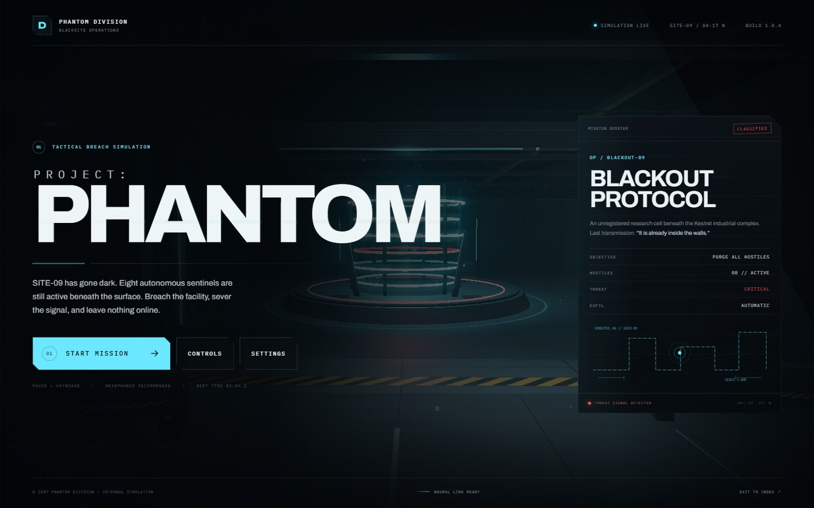
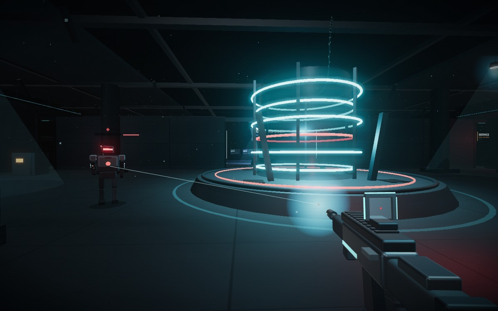
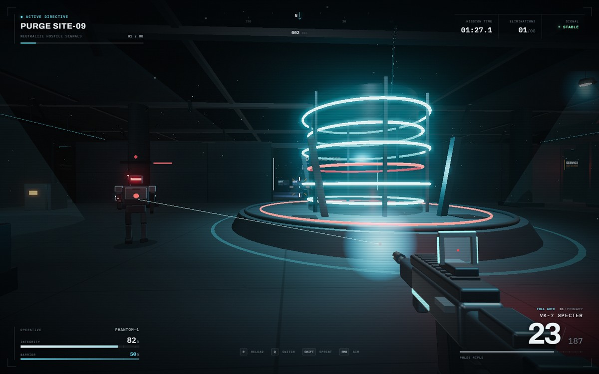

# PROJECT: PHANTOM

A playable, single-player tactical FPS running entirely in the browser. You breach **SITE-09**, an abandoned underground research facility, fight eight autonomous sentinels, and extract after the last hostile signal is gone.

Built with **Three.js + Vite**, procedural geometry/materials and Web Audio. No external models, textures, audio files, or CDNs are required.







## Quick start

Requires Node.js **20.19+** (22.12+ recommended).

```bash
cd phantom
npm install
npm run dev
# open the printed URL, usually http://localhost:5178
```

Production build:

```bash
npm run build     # writes ./dist
npm run preview   # serves the production build locally
```

On this repository the compiled build is also committed at `phantom/dist/`, so GitHub Pages can serve it without a build step:

```
https://hxstone.github.io/phantom/dist/
```

Vite is configured with `base: './'`, so the build works under any static sub-path (including GitHub Pages project sites). Do not open `dist/index.html` directly through `file://`; use a static server.

## Controls

| Input | Action |
| --- | --- |
| `W A S D` | Move |
| Mouse | Look / aim |
| Left mouse | Fire |
| Right mouse | Aim down sights |
| `R` | Reload |
| `Shift` | Sprint |
| `Space` | Jump |
| `1` / `2` / `Q` / wheel | Switch rifle / sidearm |
| `F` | Collect biocide cell |
| `Esc` | Pause / release mouse |
| `R` (end screen) | Redeploy |

The browser must grant pointer lock when **START MISSION** is clicked. If the grant is denied, click the viewport once to retry.

## Gameplay

- **VK-7 SPECTER** full-auto pulse rifle (30 / 210) and **M9 WRAITH** semi-auto sidearm (12 / 96).
- Real raycast hit detection with headshot multipliers, recoil, bloom spread, tracers, sparks, impact decals and shell casings.
- Eight sentinel androids with patrol, perception, alert, chase, strafe/attack, hit reaction and death states. They use A* navigation on a grid generated from the level colliders.
- Enemy plasma projectiles can be dodged or blocked by cover. The player has a regenerating barrier and health, plus three collectible biocide cells.
- Complete HUD: tachymeter-style compass, objective progress, health/barrier, ammunition, reload state, damage direction, hit markers, kill feed and mission timer.
- Pause, resume, victory, defeat and instant redeploy without refreshing the page.
- Procedural Web Audio: gunfire, mechanical reloads, impacts, enemy fire, hurt, heartbeat, pickup cues and a low industrial ambience bed.
- Three quality levels. High adds bloom and directional shadows; low disables shadows, bloom and reduces render scale. On integrated graphics, **BALANCED** or **LOW** is the recommended profile for a near-60 FPS target.

## Project structure

```
phantom/
├─ index.html               # UI shell, HUD, menus, dialogs
├─ src/
│  ├─ main.js               # boot, platform checks, WebGL error fallback
│  ├─ core/
│  │  ├─ Game.js            # state machine, render loop, post-processing, input wiring
│  │  ├─ Input.js           # pointer lock, mouse look, keyboard/wheel state
│  │  ├─ AudioEngine.js     # procedural Web Audio graph
│  │  └─ Settings.js        # validated localStorage settings
│  ├─ player/Player.js      # movement, collision, jump, barrier, camera feedback
│  ├─ weapons/
│  │  ├─ WeaponModel.js     # procedural first-person weapon, separate render layer
│  │  └─ WeaponSystem.js    # fire rate, reloads, raycasts, spread, ammo, hits
│  ├─ enemies/
│  │  ├─ Enemy.js           # robot model, animation, perception and combat FSM
│  │  ├─ EnemyManager.js    # spawns, projectiles, death/objective callbacks
│  │  └─ NavigationGrid.js  # collider-derived grid + A*
│  ├─ fx/Effects.js         # pooled particles, tracers, decals, shells, light flashes
│  ├─ world/
│  │  ├─ World.js           # facility, collisions, lights, props, static batching
│  │  ├─ materials.js       # shared PBR material palette
│  │  └─ TextureFactory.js  # canvas-generated concrete/metal/signage textures
│  ├─ ui/UI.js              # HUD/menu/state rendering and accessibility wiring
│  └─ styles/               # design tokens, HUD, menus + responsive rules
└─ vite.config.js
```

The static facility is merged by material at load time into a few batches while original meshes remain as invisible raycast/collision proxies. This keeps the detailed level's draw calls low.

## Notes

- Desktop Chrome/Edge with WebGL 2 is the target. Phones/tablets deliberately show a clear "desktop required" panel instead of a broken touch scheme.
- All audio starts only after the Start button gesture, satisfying browser autoplay rules.
- Settings persist to `localStorage` under `phantom.settings.v1`; best time under `phantom.bestTime.v1`.
- No analytics, accounts, external requests, or tracking.
