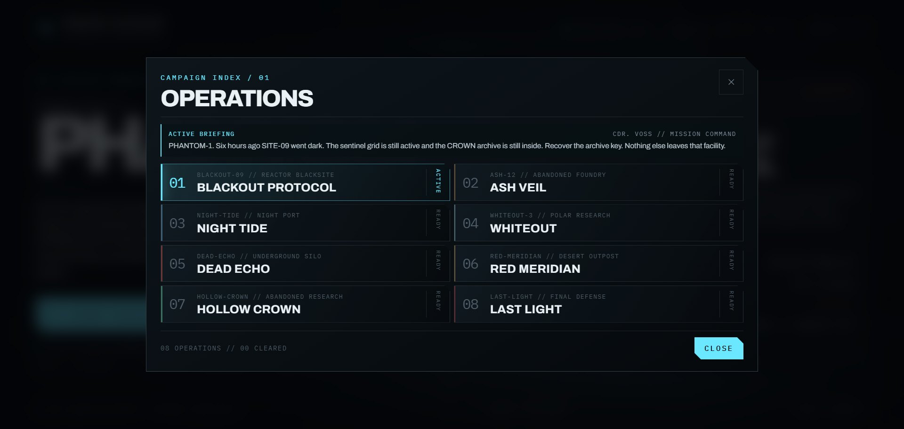
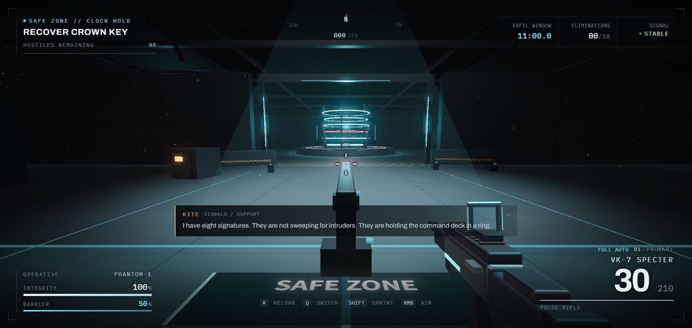
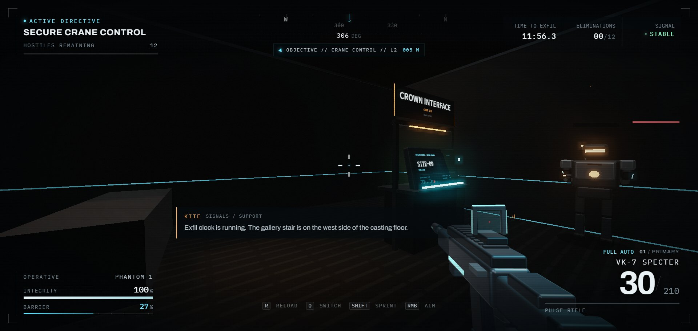
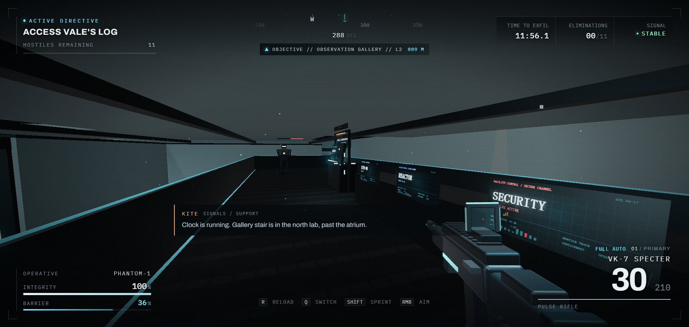
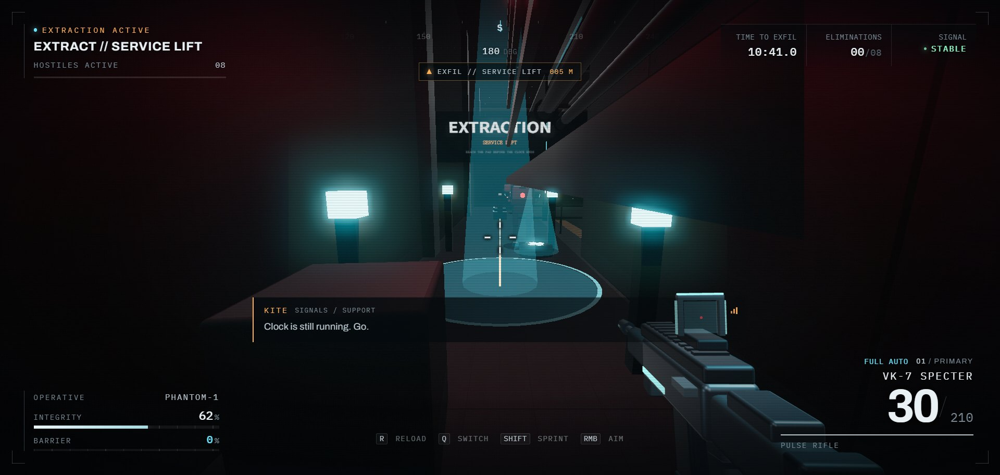
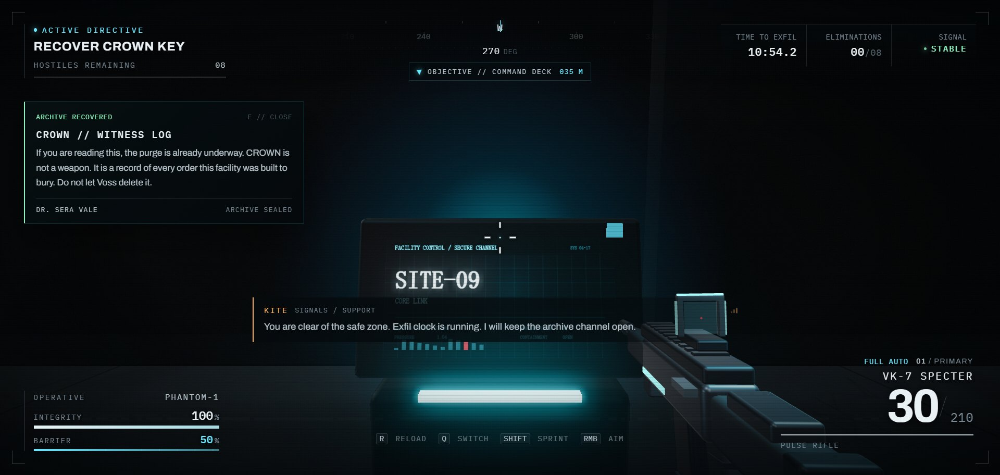

# PROJECT: PHANTOM

A playable, single-player tactical FPS campaign in the browser. **PROJECT: PHANTOM** spans eight authored blacksite operations, from SITE-09 through the Ashline foundry, K-7 night port, Vostok-3 polar station, Echo-4 launch ring, Redline-6 desert outpost and Helix-7 containment lab to the Citadel.

The campaign now runs on one continuous mission loop: deploy into a marked **safe zone**, cross the threshold to start the only countdown, secure the physical **primary objective**, then reach the **extraction pad** before that same clock expires. There is no second timer and no victory for simply clearing the map.

Built with **Three.js + Vite**, procedural geometry/materials and Web Audio. No external models, textures, audio files, backend, accounts or telemetry.














## Quick start

Requires Node.js **20.19+** (22.12+ recommended).

```bash
cd phantom
npm install
npm run dev
# open the printed URL, usually http://localhost:5178
```

Production build:

```bash
npm run build     # writes ./dist
npm run preview   # serves the production build locally
```

The compiled build is committed at `phantom/dist/`, so GitHub Pages can serve it without a build step:

```
https://hxstone.github.io/phantom/dist/
```

Vite uses `base: './'`, so the build also works under other static sub-paths. Serve `dist/index.html` over HTTP; do not open it directly with `file://`.

## Controls

| Input | Action |
| --- | --- |
| `W A S D` | Move |
| Mouse | Look / aim |
| Left mouse | Fire |
| Right mouse | Aim down sights |
| `R` | Reload |
| `Shift` | Sprint |
| `Space` | Jump |
| `1` / `2` / `Q` / wheel | Switch rifle / sidearm |
| `F` | Read/close archive, secure the primary objective, collect a biocell |
| `Esc` | Pause / release mouse |
| `R` (end screen) | Redeploy |

Pointer lock must be granted when **START MISSION** is clicked. If it is denied, click the viewport once to retry.

## Campaign

Open **MISSION INDEX** to load any operation. Selecting a card rebuilds the play space, its navigation layers and its mission flow while preserving the player, weapons, HUD and controls.

| # | Operation | Location | Identity / vertical play | Hostiles | Clock |
| --- | --- | --- | --- | --- | --- |
| 01 | BLACKOUT PROTOCOL | SITE-09 reactor blacksite | Reactor hall, command deck, insertion bay and side service corridors | 8 | 11:00 |
| 02 | ASH VEIL | Ashline foundry | Parallel casting lanes, furnace bank and a playable crane-control gallery above the west aisle | 12 | 12:00 |
| 03 | NIGHT TIDE | K-7 container quay | Container canyons, two-bay warehouse and a playable manifest office above the loading floor | 13 | 13:00 |
| 04 | WHITEOUT | Vostok-3 polar station | Sealed labs, cryo atrium and a playable observation gallery over the north lab | 11 | 12:00 |
| 05 | DEAD ECHO | Silo ECHO-4 | Circular launch ring, four control cells and a playable west launch-control gantry | 14 | 12:00 |
| 06 | RED MERIDIAN | Redline-6 desert outpost | Open killing ground, radar array, hangar and the preauthorization ops block | 12 | 12:30 |
| 07 | HOLLOW CROWN | Helix-7 containment lab | Glass labs, observation ring and the sealed containment pod | 10 | 12:00 |
| 08 | LAST LIGHT | Citadel Black | Three defensive waves, central uplink tower and a timed causeway escape | 15 | 14:00 |

Every spawn, patrol route, stair, deck, terminal, objective and extraction pad is authored and validated against the collider-derived navigation grid. Geometry is never randomly scattered at runtime.

## Story

The campaign is **THE CROWN WITNESS**.

- **CROWN** is an autonomous witness archive built to preserve command orders that could otherwise be deleted. It recorded Operation BLACKOUT — including the order to erase its witnesses — before the operation existed.
- **Commander Voss** sends PHANTOM-1 to purge SITE-09 and recover the archive. She insists Dr. Sera Vale is dead and that CROWN is a compromised weapon.
- **KITE**, signals support, finds the conflicting timestamps and gradually moves onto a channel Voss cannot control.
- **Dr. Sera Vale**, CROWN's architect, is alive. She woke the sentinel grid deliberately to keep CROWN out of Voss's hands.
- **WARDEN**, the command-grade sentinel voice, is the command engram of PHANTOM-6 — an earlier iteration who chose the archive over obedience.
- PHANTOM-1 is **iteration nineteen**. The same operative has been deployed, wiped and redeployed eighteen times; Voss has been cleaning up both the record and the person.

The two turns are concrete and playable: Vale is not a hostage, and the player is not a fresh operative. The final operation changes the objective from destruction to **broadcasting the archive**, then requires an escape before the Citadel causeway closes.

Narrative delivery uses only existing HUD language: a pre-mission briefing in the mission index, radio subtitles, optional diegetic archive terminals readable with `F`, environmental evidence in the map, and a KITE debrief after extraction. No dialogue tree or external voice service is required.

## One mission clock

`MissionDirector` is the single authority for mission state, elapsed time and remaining time.

```
SAFE_ZONE
  └─ player crosses the marked boundary
MISSION_ACTIVE
  └─ objective console secured
OBJECTIVE_COMPLETED
  └─ extraction pad opens immediately
EXTRACTION_ACTIVE
  ├─ player enters the pad before 00:00 → MISSION_SUCCESS
  └─ clock reaches 00:00 → MISSION_FAILED
```

- **Safe zone:** no countdown, no hostile attacks, no projectile damage, no player damage. The player can observe the space and listen to the briefing before leaving.
- **One countdown:** leaving the safe zone starts it exactly once. Re-entering the safe zone cannot pause or reset it.
- **Objective completion does not reset time:** the player keeps whatever time remains. The HUD switches to the extraction marker and distance.
- **Extraction is physical:** victory requires entering the authored pad while the clock is above zero. Clearing every hostile, waiting, or completing only the objective never awards victory.
- **Timeout:** the clock reaching zero is a defeat, with level-specific failure copy.
- **Restart:** enemy roster, waves, projectiles, terminals, alarms, objective console, extraction pad, radio queue, timer and player state are all returned to the safe-zone state.
- **Extraction pressure:** securing the objective triggers alarms and releases authored reserve spawns. A reserve whose spawn point is too close, or is in an unobstructed line of sight inside engagement range, is deferred until the player moves or breaks the sightline, so enemies do not pop in at arm's length.

Each operation has a 11–14 minute budget, tuned to map size and route length rather than forcing one constant time on every layout.

## Vertical spaces

Four operations contain genuine second levels rather than decorative mezzanines:

- **Ashline Foundry — Crane Control Gallery:** a stair from the casting floor lands on a 4.2 m deck with a control console, rails and two upper-floor defenders. The production log is the primary objective.
- **K-7 Terminal — Manifest Office:** an interior stair in the warehouse loading bay reaches a 4.0 m office above the cargo floor.
- **Vostok-3 — Observation Gallery:** a stair from the north lab reaches a 2.8 m gallery overlooking the cryo atrium, with Vale's observation console and upper sentinels.
- **ECHO-4 — Launch Control Gantry:** a 3.8 m gantry on the west wall of the launch ring holds the launch record and two elevated defenders.

Implementation details:

- Decks, stairs and rails register real colliders, so the existing player step-up controller climbs them without a new movement mode.
- Upper floors get a separate navigation layer built from the same collider set. Floor slabs below a sentinel are ignored; rails, consoles and furniture at its own level are respected.
- Upper sentinels detect, aim, charge and fire from their deck. Their vision is a 3D raycast, so floor slabs block sight and shots; they cannot shoot through the deck at a player below.
- In the current implementation, upper sentinels hold their authored deck layer rather than dynamically switching between stair layers during a chase. They still patrol, take cover positions, react to the player and participate in the fight; this is a navigation-layer limitation, not a cosmetic upper floor.

The other operations remain intentionally flatter but use their own spatial identities: the Citadel's radial bastions and tower, Redline-6's hangar/radar silhouette, Helix-7's containment pod ring, and SITE-09's reactor gallery.

## Combat and AI

- **VK-7 SPECTER** full-auto pulse rifle (30 / 210) and **M9 WRAITH** semi-auto sidearm (12 / 96).
- Hitscan raycasts with headshot multipliers, recoil, bloom, tracers, sparks, impact decals and shell casings.
- Six sentinel roles share the patrol → alert → chase → attack FSM but use space differently:
  - **assault** closes distance and pushes lanes;
  - **defender** holds mid-range sightlines;
  - **marksman** keeps distance with a long, visible charge;
  - **heavy** advances slowly with more armor;
  - **elite** pressures faster and flanks;
  - **commander** anchors command spaces and deals higher sustained damage.
- The role mix is deterministic per operation. Later waves and special roles are authored spawn data, not infinite respawns.
- Enemy plasma projectiles are dodgeable and collide with world geometry.
- The player has health, a regenerating barrier, three biocells per operation and the existing pause/retry flow.
- Alarm lighting, reserve deployments and radio beats change the pace when the primary objective is secured.

## HUD and mission feedback

The existing visual language is preserved. New gameplay information is folded into it:

- Safe-zone / active / extraction state in the objective kicker.
- Frozen `EXFIL WINDOW` timer before the threshold; live `TIME TO EXFIL` countdown after it.
- A compact objective/extraction waypoint below the compass, with relative bearing, distance and `L2` when the target is upstairs.
- Existing radio subtitle strip and archive card for story delivery.
- Existing objective console prompt with `F`.
- Level-specific extraction labels and physical pads with pylons, rings and a restrained beacon.
- Level-specific failure copy for clock expiry versus player death.

The menu, HUD typography, color palette, pointer-lock controls and weapon handling are unchanged.

## Project structure

```
phantom/
├─ index.html               # UI shell, HUD, menus, dialogs
├─ src/
│  ├─ main.js               # boot, platform checks, WebGL error fallback
│  ├─ core/
│  │  ├─ Game.js            # game loop, level switching, event wiring, debug API
│  │  ├─ Input.js           # pointer lock, mouse look, keyboard/wheel state
│  │  ├─ AudioEngine.js     # procedural Web Audio graph
│  │  └─ Settings.js        # validated localStorage settings
│  ├─ player/Player.js      # movement, collision, jump, step-up, barrier
│  ├─ weapons/              # procedural weapon model + hitscan combat
│  ├─ enemies/
│  │  ├─ Enemy.js           # sentinel model, animation, perception, combat FSM
│  │  ├─ EnemyManager.js    # squad, floor navs, projectiles, deferred reserves
│  │  └─ NavigationGrid.js  # collider-derived floor-aware grid + A*
│  ├─ campaign/
│  │  ├─ narrative.js       # characters, radio script, terminal copy, story beats
│  │  ├─ CampaignDirector.js# radio, terminals, alarm/reserve story beats
│  │  └─ MissionDirector.js # authoritative state, timer, objective, extraction
│  ├─ levels/
│  │  ├─ catalog.js         # operation metadata, briefing copy, time limits
│  │  └─ layouts.js         # authored layouts, decks, stairs, story props
│  ├─ world/
│  │  ├─ World.js           # SITE-09, mission props, vertical kit, collisions
│  │  ├─ materials.js       # shared PBR palette
│  │  └─ TextureFactory.js  # procedural textures and signage
│  ├─ ui/UI.js              # HUD/menu renderer and accessibility wiring
│  └─ styles/               # design tokens, HUD, menus, responsive rules
└─ vite.config.js
```

Each operation is merged by material at load time into a few batches while original meshes remain as precise raycast/collision proxies. Only the selected operation and its sentinel squad remain resident. Switching levels releases the previous world's geometry, lights, generated label materials, navigation grids and projectile assets.

## Persistence

- Settings: `phantom.settings.v1`.
- Best extraction time and completed operations: `phantom.bestTimes.v1`, `phantom.completed.v1`.
- The original single-mission `phantom.bestTime.v1` value is migrated to SITE-09 on first read.
- Story progress is intentionally not saved: each operation is replayable from its safe zone, and restart fully resets its mission state.

## Tested

- `vite build` succeeds.
- All eight operations validate with zero blocked spawns, routes, objective approaches, extraction points or terminal approaches.
- All eight operations complete through the full success path: safe zone → active clock → objective console → extraction → victory → debrief.
- Safe-zone hold: timer stays frozen; direct damage returns zero; leaving starts exactly one clock; re-entering does not reset or pause it.
- Objective completion: timer keeps decreasing, extraction becomes active, and victory requires entering the pad.
- Entering extraction before the objective does not win. Killing every hostile without extracting does not win.
- Clock expiry fails the mission; player death fails the mission; restart clears timer, alarms, objective, enemy deaths and extraction state.
- Foundry, Port, Polar and Silo stairs were traversed under the real player controller; deck heights reached 4.2 m, 4.0 m, 2.8 m and 3.8 m.
- Upper sentinels tracked, attacked and damaged the player from their decks. A player under the Foundry deck was not visible to them, confirming floor-slab line-of-sight blocking.
- Citadel: three waves (6 / 5 / 4), command-guard objective switch, uplink interaction, continued countdown and final causeway extraction.
- Hitscan raycasts, ammo, damage and upper-floor hit meshes were verified in the running build.
- Mobile fallback still shows the desktop-required panel and does not initialize the game.

## Not yet covered

- No full human-controlled playthrough of all eight maps from start to extraction; flow tests used the game's deterministic simulation/debug API plus browser rendering.
- No fresh long-duration FPS benchmark on integrated graphics after the new decks, labels and extra lights. The additions reuse the existing material/geometry kit and one extra navigation grid per level; verify HIGH/BALANCED on the target machine before claiming a frame-rate target.
- Upper-floor enemy AI is floor-locked during a chase. It fights from its deck but does not switch layers via the stairs.
- No Firefox/Safari or audio-device matrix testing. Desktop Chrome/Edge with WebGL 2 remains the target.
